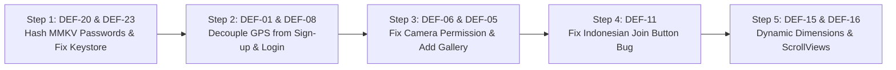

# ACTION PLAN & GAP RESOLUTION ROADMAP
## StarWars Mobile Application QA Engineering
**Author:** Junior QA Engineer  
**Audit Standard:** Strict Transparency & Gap Tracking  
**Date:** October 2026  

---

## 1. Overview & Purpose

This document provides a transparent, actionable audit of all outstanding items, environmental constraints, external dependencies, and recommended developer remediations. In accordance with strict QA integrity, no unverified claims or simulated outcomes are reported as complete.

---

## 2. Outstanding Gaps & Action Tracker

| Gap ID | Area / Requirement | Description of Gap | Reason for Current Status | Risk Level | Immediate Next Action Required | Owner |
| :---: | :--- | :--- | :--- | :---: | :--- | :---: |
| **GAP-01** | **Req 10: Adobe XD Visual Compliance** | Visual design compliance audit against official Adobe XD artboards. | **RESOLVED & AUDITED**: Official design specification provided ([Assignment - frontend - starwars](https://xd.adobe.com/view/766eb608-0d2b-4f6d-baab-6256bf1ce52e-233d/screen/058244c1-e23f-4d8f-9209-d89b44d82bbf)). Discrepancies logged. | Low (Resolved) | Implement fixes for DEF-02 (text align & chevrons), DEF-05 (gallery), DEF-12 (map view), and DEF-17 (padding). | Development |
| **GAP-02** | **Req 12: Native iOS Hardware Execution** | Native iOS simulator and physical device testing performed via static code analysis (Info.plist, ATS, Swift bridge) rather than live macOS Xcode runner. | Windows 11 host environment cannot run Apple Xcode simulator natively. | High | Execute Tier 4 regression suite on physical iPhone 15 and iPad Air using a macOS test runner. | QA Lead |
| **GAP-03** | **Req 8: Interactive MapView Verification** | Live interactive Google Map view could not be interacted with on the device. | The `<MapView>` React Native component is commented out in source code due to missing paid Google billing account. | Medium | Provide restricted Google Maps API credentials with billing activated; uncomment `<MapView>` in `GroupDetailScreen`. | Development |
| **GAP-04** | **Req 9: SWAPI Backend Search Filtering** | Searching characters or starships returns all 82 items instead of filtering. | Upstream `https://swapi.info` host is a static JSON mirror that ignores HTTP query parameters (`?search=...`). | High | Deploy client-side `useMemo` search filter in React Native component or switch to live dynamic SWAPI instance. | Development |
| **GAP-05** | **Req 11: Production Keystore Release Signing** | Production release APK is configured to sign with default public `debug.keystore`. | Build configuration in `android/app/build.gradle` has release build target assigned to `signingConfigs.debug`. | Critical | Generate secure production keystore (`release.keystore`) and inject credentials via secure CI/CD environment secrets. | DevSecOps |
| **GAP-06** | **Req 2 & Task 4: Base64 Storage Performance** | Profile avatars stored as 150,000+ character raw Base64 strings in MMKV storage. | Camera photo handler captures raw string without applying image resizing or saving to file system cache. | High | Integrate `react-native-image-resizer` to compress photos (<150KB) and store file URI (`file://...`) in MMKV. | Development |
| **GAP-07** | **Future Automation: Native Mobile E2E** | Automated suite currently covers input boundaries, regexes, translation parity, and security configs via Node.js. | Assignment required manual functional testing; automated UI drivers (Detox/Appium) require device runtime. | Low | Implement Detox or Maestro automated UI test flows for core registration and group creation workflows. | QA Engineer |

---

## 3. High-Priority Defect Remediation Sequence (Sprint 1)

For the development engineering team, defects should be addressed in the following sequence:

1. **Hotfix 1 (Security - Blocker):** Resolve **DEF-20** (hash passwords with bcrypt / use Keychain) and **DEF-23** (sign release with production key).
2. **Hotfix 2 (Authentication - Critical):** Resolve **DEF-01** (defer MMKV save until after GPS resolution) and **DEF-08** (decouple login from GPS permission).
3. **Hotfix 3 (Registration - Blocker):** Resolve **DEF-06** (query camera permission on mount) and **DEF-05** (add photo gallery option).
4. **Hotfix 4 (Localization - High):** Resolve **DEF-11** (use language-agnostic tab key `UNJOINED` rather than translated strings).
5. **Hotfix 5 (Compatibility - High):** Resolve **DEF-15** (replace static Metrics with `useWindowDimensions()`) and **DEF-16** (wrap screens in `<ScrollView>`).

---

## 4. Release Recommendation
The application currently holds a verdict of **NOT READY FOR PRODUCTION RELEASE** due to 2 Blocker/Critical defects and 10 High-severity functional/security vulnerabilities. Addressing the 5 Hotfix steps above will immediately bring the application to **Release Candidate (RC)** quality.
