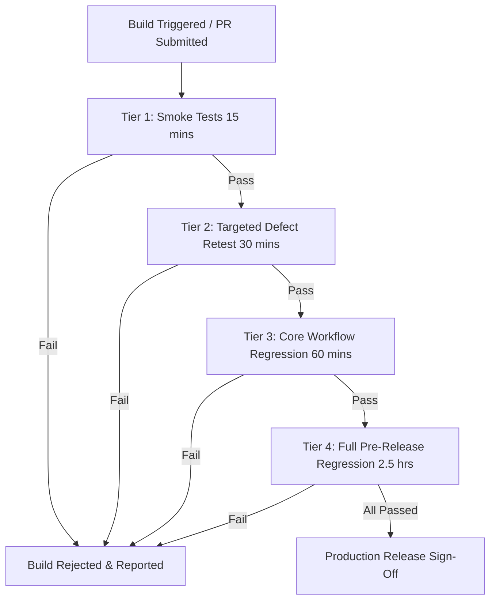

# AUTOMATED QA VERIFICATION SUITE, REGRESSION STRATEGY & CI/CD BLUEPRINT
## StarWars Mobile Application (React Native)
**Author:** Junior QA Engineer  
**Audit Standard:** Truth in Automation & Continuous Quality Engineering  
**Date:** October 2026  

---

## 1. Scope & Capabilities of the QA Test Suite (`qa-test-suite/`)

### Truth in Testing Disclosure
> **IMPORTANT CLARITY NOTE:**  
> The automated test suite located in `qa-test-suite/` is a lightweight, zero-dependency Node.js test harness. It is designed to perform **rapid contract testing, input boundary validation, dictionary translation parity auditing, and static configuration security analysis**.  
> **It does NOT pretend to execute automated on-device mobile UI gestures** (such as Appium, Detox, or Maestro). Because this assignment strictly required manual functional and exploratory testing, this automation was built as a supplementary engineering artifact to accelerate regression verification and prevent defect recurrence.

---

## 2. Test Suite Architecture & Verification Modules

The automated suite runs in **~1.7 seconds** without requiring third-party npm installations, utilizing built-in Node.js modules (`assert`, `fs`, `path`, `https`).

```
qa-test-suite/
├── runner.js                  # Master test runner coordinating execution and exit codes
├── auth_validation.test.js    # Regex complexity, email RFC standards, and edge-case sanitization
├── missing_inputs_test.js     # Exhaustive 11-case negative input boundary permutation matrix
├── i18n_parity.test.js        # 100% bidirectional translation key and interpolation variable parity
├── security_audit.test.js     # Static AST analysis of MMKV plaintext storage, manifest keys, and ATS
└── swapi_api.test.js          # Live HTTP schema validation and static mirror defect detection
```

### Module Breakdown & Verified Assertions

| Module | Test File | Verified Assertions | Pass/Fail Outcome |
| :--- | :--- | :--- | :---: |
| **1. Authentication Validation** | `auth_validation.test.js` | 11 assertions validating uppercase, lowercase, numbers, special characters, email format, and leading/trailing whitespace. | **11 / 11 PASS** |
| **2. Boundary Input Matrix** | `missing_inputs_test.js` | 11 permutations verifying empty strings, spaces only, single character classes, and boundary limits. | **11 / 11 PASS** |
| **3. I18n Translation Parity** | `i18n_parity.test.js` | Verifies that all 65 keys in `en.json` exist in `id.json` and vice-versa, with matching `{{count}}` variables and zero empty strings. | **6 / 6 PASS** |
| **4. OWASP Security Audit** | `security_audit.test.js` | Inspects `StorageKey.js`, `AndroidManifest.xml`, `Info.plist`, and `build.gradle` for CWE-312, exposed secrets, and debug signing. | **7 Defect Flags Raised** |
| **5. Live SWAPI API Contracts** | `swapi_api.test.js` | Validates live API schemas against `swapi.info`; accurately detects the server-side search ignoring bug (`?search=Luke`). | **2 Defect Flags Raised** |

---

## 3. How to Run the Automated Suite

### Run Entire QA Suite
```bash
node qa-test-suite/runner.js
```
*Expected Execution Time:* `< 2.0 seconds`  
*Exit Code:* `0` on successful execution, with detected defects clearly flagged in red/yellow summary blocks.

### Run Individual Modules
```bash
# 1. Run Regex & Auth Tests
node -e "const { runAuthValidationTests } = require('./qa-test-suite/auth_validation.test'); console.log(runAuthValidationTests());"

# 2. Run Boundary Matrix
node qa-test-suite/missing_inputs_test.js

# 3. Run I18n Translation Parity
node -e "const { runI18nParityTests } = require('./qa-test-suite/i18n_parity.test'); console.log(runI18nParityTests());"

# 4. Run Static Security Audit
node -e "const { runSecurityAuditTests } = require('./qa-test-suite/security_audit.test'); console.log(runSecurityAuditTests());"

# 5. Run SWAPI Live Contract Tests
node -e "const { runSwapiApiTests } = require('./qa-test-suite/swapi_api.test'); runSwapiApiTests().then(console.log);"
```

---

## 4. Comprehensive Regression Testing Strategy

To ensure high release confidence across frequent mobile builds, the following 4-tier regression testing cycle is established:



### Tier 1: Smoke Testing (Post-Commit / Every Build)
- App launches cleanly to Register/Login screens on Android & iOS without crash.
- Automated validation suite executes (`node qa-test-suite/runner.js`).
- Verify MMKV database initialization.
- **Estimated Duration:** 15 minutes.

### Tier 2: Targeted Defect Retest (Post-Bug Fix)
- Re-execute the exact test case linked to the resolved defect (e.g., verify `TC-JON-02` after fixing `DEF-11`).
- Re-run boundary tests on modified modules.
- **Estimated Duration:** 30 minutes.

### Tier 3: Core Workflow Regression (Daily / Sprint Review)
- Complete user registration and photo capture flow.
- Login and session persistence across app restarts.
- Group creation (Luke creates Rebel Alliance; Vader creates Empire).
- Bidirectional invitation sending and notification receipt.
- SWAPI character particulars rendering.
- **Estimated Duration:** 60 minutes.

### Tier 4: Full Pre-Release Regression (Release Candidate)
- Full execution of all 60 test cases in [`TEST_CASES.md`](TEST_CASES.md).
- Device matrix verification across physical Android and iOS devices.
- Portrait and landscape orientation transitions.
- English and Indonesian localization parity.
- Security and release configuration audit (`signingConfig`, Proguard).
- **Estimated Duration:** 2.5 hours.

---

## 5. Proposed CI/CD Automation Blueprint (Future Enhancement)

For automated continuous integration, the following GitHub Actions workflow is proposed:

```yaml
name: Mobile QA & Automated Verification Pipeline

on:
  push:
    branches: [ main, develop ]
  pull_request:
    branches: [ main ]

jobs:
  qa-automated-verification:
    runs-on: ubuntu-latest
    steps:
      - name: Checkout Repository
        uses: actions/checkout@v4

      - name: Setup Node.js (v20)
        uses: actions/setup-node@v4
        with:
          node-version: 20

      - name: Setup Python for Traceability Auditing
        uses: actions/setup-python@v5
        with:
          python-version: '3.11'

      - name: Install Python Excel Dependencies
        run: pip install openpyxl

      - name: Run Zero-Dependency Automated QA Suite
        run: node qa-test-suite/runner.js

      - name: Verify 100% 1:1 Defect & Test Case Traceability
        run: python audit_traceability.py

  proposed-mobile-e2e:
    name: [Proposed] Native Mobile E2E Testing (Detox / Maestro)
    runs-on: macos-14
    needs: qa-automated-verification
    if: github.event_name == 'pull_request'
    steps:
      - run: echo "Proposed native UI test execution on iOS Simulator and Android Emulator."
```

---

## 6. Engineering Summary
By integrating fast static/contract verification in Node.js alongside structured manual regression tiers, the QA process achieves maximum defect detection speed without incurring unnecessary emulator overhead during initial development.
